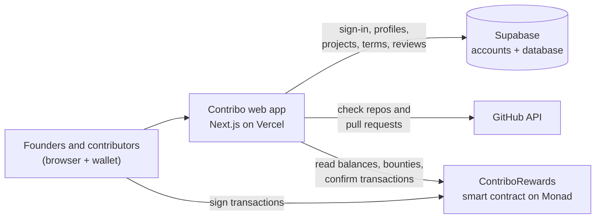

<div align="center">

# Contribo

**Build together, get recognized, and share in the success of what you help build.**

A rewards platform for open-source contributors in the Monad ecosystem. Founders lock real funds behind clear reward terms *before* work starts. Contributors ship pull requests, and accepted work is paid out from those funds on Monad.

[**Open the app**](https://trycontribo.vercel.app) · [Explore projects](https://trycontribo.vercel.app/projects) · [Smart contract](#live-deployment) · [Source code](https://github.com/sniperchief/Contribo)

</div>

---

## Contents

1. [Why Contribo](#why-contribo)
2. [Live deployment](#live-deployment)
3. [How it works](#how-it-works)
4. [Architecture](#architecture)
5. [Security and trust](#security-and-trust)
6. [The smart contract](#the-smart-contract)
7. [Tech stack](#tech-stack)
8. [Run it locally](#run-it-locally)
9. [Deploy your own copy](#deploy-your-own-copy)
10. [Testing](#testing)
11. [Project structure](#project-structure)
12. [Known limitations](#known-limitations)
13. [Notes for contributors](#notes-for-contributors)

---

## Why Contribo

Open-source work often goes unrewarded, and when rewards are offered, they are easy to change after the work is done:

- **Merged work leaves no record.** A contributor's pull request disappears into a commit log with no credit attached.
- **Terms change after the fact.** "We'll take care of you" becomes something else once the code is merged.
- **Opportunities are scattered** across chats, forums and repositories.

Contribo fixes this with three simple rules:

1. **Terms first.** A founder publishes the reward terms before anyone starts.
2. **Money first.** The project only appears on Contribo once its reward funds are locked in a public smart contract on Monad.
3. **Proof of work.** Contributions are checked against GitHub, so only real, merged pull requests by the contributor's own account count.

---

## Live deployment

| | |
| --- | --- |
| **Web app** | [https://trycontribo.vercel.app](https://trycontribo.vercel.app) |
| **Network** | Monad Testnet (chain ID `10143`) |
| **Rewards contract** (`ContriboRewards`) | [`0xf2080fC3CDBeFa5577b5c185794dBfAB348DD5D3`](https://testnet.monadvision.com/address/0xf2080fC3CDBeFa5577b5c185794dBfAB348DD5D3) |
| **Deployment transaction** | [`0x61d56882…e7f96e67`](https://testnet.monadvision.com/tx/0x61d568826e866fb47ea6b89cfe3d05e25acca9a35d00e49bd1173185e7f96e67) |
| **Deployed** | 10 October 2026, block `69,808,471` |
| **Platform admin** (can pause new activity, cannot move funds) | [`0x0c2c06e426F09f33c64d45Fa62782C9FF9FB9fa4`](https://testnet.monadvision.com/address/0x0c2c06e426F09f33c64d45Fa62782C9FF9FB9fa4) |
| **Deployer** | [`0x44d826e1d9a51239c8717fe7bc785985ec0d6ca1`](https://testnet.monadvision.com/address/0x44d826e1d9a51239c8717fe7bc785985ec0d6ca1) |
| **Source code verification** | Exact ("perfect") match on Sourcify: [check status](https://sourcify-api-monad.blockvision.org/check-by-addresses?addresses=0xf2080fC3CDBeFa5577b5c185794dBfAB348DD5D3&chainIds=10143) |
| **Compiler** | Solidity `0.8.30`, optimizer on (200 runs), EVM version `prague` |

### Verify it yourself

You don't have to trust this README. Each of these checks takes a minute:

1. **See the contract and its activity** on a block explorer:
   - [MonadVision](https://testnet.monadvision.com/address/0xf2080fC3CDBeFa5577b5c185794dBfAB348DD5D3)
   - [Monad Explorer](https://testnet.monadexplorer.com/address/0xf2080fC3CDBeFa5577b5c185794dBfAB348DD5D3)
2. **Confirm the published source code matches what is deployed.** The [Sourcify check](https://sourcify-api-monad.blockvision.org/check-by-addresses?addresses=0xf2080fC3CDBeFa5577b5c185794dBfAB348DD5D3&chainIds=10143) should report `"status": "perfect"`. The source lives in [contracts/src/ContriboRewards.sol](contracts/src/ContriboRewards.sol).
3. **Read the contract directly** with [Foundry](https://getfoundry.sh) (no wallet needed):
   ```bash
   RPC=https://testnet-rpc.monad.xyz
   ADDR=0xf2080fC3CDBeFa5577b5c185794dBfAB348DD5D3
   cast call $ADDR "owner()(address)" --rpc-url $RPC         # platform admin
   cast call $ADDR "projectCount()(uint256)" --rpc-url $RPC  # projects registered so far
   cast call $ADDR "paused()(bool)" --rpc-url $RPC           # false while operating normally
   ```
4. **Check any project's balances.** Every public project page on [trycontribo.vercel.app](https://trycontribo.vercel.app/projects) shows its live balances, read straight from the contract.

> Contribo runs on **testnet**. Testnet MON has no real value; get some from the [Monad faucet](https://faucet.monad.xyz). The contract has not been independently audited yet. See [Known limitations](#known-limitations).

---

## How it works

### For founders: create a project in three steps

From **My projects → + Create a project**:

1. **Repository.** Paste a GitHub link or start typing to search your own repositories. If the repository belongs to your GitHub account, it is verified instantly. For an organization repository, Contribo gives you a small file to add to it, which proves you can manage it.
2. **Rewards.** Choose **one** reward type:
   - **Bounties**: a fixed amount for a specific task, with a deadline. Add one or more.
   - **Contributor pool**: a percentage of your future funding reserved for contributors, plus a first deposit.

   Pay in MON or any token on Monad. Contribo writes clear reward terms for you, and you can edit them.
3. **Review and launch.** One button runs a checklist and asks your wallet to approve each step:
   1. publish your reward terms
   2. register the project in the smart contract
   3. lock the funds
   4. create each bounty
   5. list the project on Explore

   If anything stops halfway, **Continue launch** picks up exactly where it left off and never repeats a payment.

Your progress is saved after every step. Unfinished projects show **In setup · step X of 3** on My projects.

After launch, the project page is where you review contributions, add more bounties or funds, and manage approvers (trusted wallets that can approve rewards with you). Projects show **Live** while open and **Ended** once you close them.

### For contributors: find work, ship it, get paid

1. **Sign in with GitHub** and choose "contributor" during onboarding.
2. **Link a payout wallet** by signing a short message. This costs nothing and sends no transaction.
3. **Explore projects**, read their reward terms and open bounties, and contribute through normal pull requests.
4. **Submit your merged pull request** on the project's page. Contribo detects your merged pull requests automatically, or you can paste a link.
5. **Get approved.** The founder or an approver reviews it and approves a reward. The reward is then reserved for your wallet in the contract, and nobody can take it back.
6. **Claim** the reward to your wallet from **Contributions**.

### The life of a contribution

| Stage | What it means | Where it's recorded |
| --- | --- | --- |
| **Detected** | A merged pull request by you in a verified repository, found on GitHub | GitHub (not saved) |
| **Verified** | Contribo checked on GitHub that it's yours, merged, and in the right repository | Contribo database |
| **Accepted** | The founder chose a reward for it (a bounty or a pool amount) | Contribo database |
| **Approved onchain** | The reward is reserved for your wallet in the smart contract | Monad |
| **Claimable** | Approved, and you're connected with the receiving wallet | Monad + your wallet |
| **Paid** | You claimed it | Monad |
| **Rejected** | Not eligible for a reward | Contribo database |

A verified pull request is **evidence, not payment**. Nothing is paid until a person approves it and the approval is confirmed onchain.

---

## Architecture



Contribo has four parts. Each one is the source of truth for something different:

| Part | What it does | Source of truth for |
| --- | --- | --- |
| **Web app** (Next.js, hosted on [Vercel](https://trycontribo.vercel.app)) | The pages people use, plus server code that checks GitHub, confirms transactions and enforces the rules | Nothing stored; it coordinates the other parts |
| **Supabase** (accounts and PostgreSQL database) | GitHub sign-in, profiles, projects, reward terms, contribution reviews | Who people are, what was promised, what was reviewed |
| **GitHub** | Repositories and pull requests | Who wrote and merged what |
| **ContriboRewards** (smart contract on Monad) | Holds the money, reserves approved rewards, pays claims | Where every token is |

### Key design choices

- **Money lives only in the smart contract.** The web app never holds funds or private keys. Every payment-related action is signed by a person in their own wallet.
- **The database follows the chain, not the other way around.** After a transaction confirms, the server reads the result back from Monad and only then updates the database. A transaction is never shown as successful before it is confirmed.
- **The terms are fingerprinted onchain.** When terms are published, Contribo computes a unique fingerprint (a hash) of them and stores it in the contract. Rewards can only be approved while the onchain fingerprint matches the published terms, so the terms can't quietly change.
- **One reward type per project.** Bounties or a contributor pool, never both, which keeps the terms easy to read.
- **Going live is checked by the server.** A project is listed on Explore only after the server confirms onchain that it is registered with the published terms and funded. Users cannot flip that switch themselves.

### Pages

| Page | Who | What it's for |
| --- | --- | --- |
| [`/`](https://trycontribo.vercel.app) | Everyone | Landing page with live total paid out |
| [`/projects`](https://trycontribo.vercel.app/projects) (Explore) | Everyone | Browse live projects; search and sort |
| `/projects/[slug]` | Everyone | Reward terms, verified repositories, live balances and open bounties; contributors submit pull requests here |
| [`/login`](https://trycontribo.vercel.app/login) | Everyone | Sign in or sign up with GitHub |
| `/welcome` | New users | Choose contributor or founder, link a wallet (optional) |
| [`/dashboard`](https://trycontribo.vercel.app/dashboard) (Contributions) | Contributors | Your pull requests by stage, and claims |
| [`/founder`](https://trycontribo.vercel.app/founder) (My projects) | Founders | Your projects, and their setup progress |
| `/founder/new` | Founders | The three-step project setup |
| `/founder/[id]` | Project owner and approvers | Manage details, repositories, terms, funding, bounties and approvers; review contributions |
| [`/profile`](https://trycontribo.vercel.app/profile) | Signed-in users | GitHub details, payout wallet, social links and skills |

---

## Security and trust

### What protects users

- **GitHub identity can't be faked.** Sign-in goes through GitHub, and every check uses GitHub's permanent numeric IDs, so renaming an account or repository can't trick the system. Nobody can claim someone else's pull request.
- **Repository ownership is proven.** Either the repository belongs to the founder's own GitHub account, or the founder adds a one-time verification file to it. A repository can be verified by only one project.
- **Wallets are proven by signature.** A payout wallet is linked by signing a message tied to that user, which expires after 10 minutes. Rewards can only go to a wallet linked this way.
- **The database has strict access rules.** Supabase's Row Level Security (database rules that decide who can read or change each row) is on for every table. Sensitive fields can only be written by the server, after it has done its own checks: verification results, wallet addresses, onchain links and project status.
- **Secrets stay on the server.** The database admin key and the GitHub token are only used in server code and never reach the browser.
- **Approved rewards are locked.** Once a reward is approved onchain, no one (not the founder, approvers or the platform admin) can withdraw, redirect or cancel it. Only the contributor can claim it.

### What you still have to trust

- **The contract can't see GitHub.** Contributors rely on Contribo's server to check pull requests, and on each project's owner and approvers to approve fairly. Approvals are public onchain, so misuse is visible, but it isn't prevented.
- **Unallocated funds belong to the founder.** Money in a project's pool that hasn't been put into a bounty or approved for someone can be withdrawn by the founder. Bounty funds are locked until the bounty's deadline.
- **Not audited.** Get an independent security audit before any mainnet use.

---

## The smart contract

One contract, [ContriboRewards](contracts/src/ContriboRewards.sol), does everything onchain: it is the project registry, the vault that holds funds, and the reward ledger. Keeping it in one contract means one set of balance books. Its types, events and errors are in [IContriboRewards](contracts/src/interfaces/IContriboRewards.sol).

### Where the money goes

Each project's funds sit in one of these buckets:

```
deposited ──► available ──► escrowed (a bounty) ──► committed (approved for a contributor) ──► paid
                 │                 │
                 └─► withdrawn     └─► back to available if the bounty expires unawarded
```

| Step | Function | Who |
| --- | --- | --- |
| Register a project, fixing its payment token and terms fingerprint | `registerProject` | Anyone (they become the owner) |
| Add funds | `deposit` | Anyone |
| Lock funds in a bounty with a deadline | `createBounty` | Owner |
| Approve a reward from the pool | `approveContribution` | Owner or approver |
| Award a bounty | `awardBounty` | Owner or approver |
| Claim an approved reward to any address | `claim` | The contributor |
| Take back unused funds | `withdraw` (available funds only) | Owner |
| Release an expired, unawarded bounty | `cancelBounty` (after deadline) | Owner |
| Update the terms fingerprint, add or remove approvers, hand over ownership | `setPolicyHash`, `setApprover`, `transferProjectOwnership` / `acceptProjectOwnership` | Owner |
| Pause new activity in an emergency | `pause` / `unpause` | Platform admin |

The books always balance, and the tests check this after thousands of random operations:

```
total deposited = available + escrowed + committed + paid + withdrawn
```

### Safety rules built into the contract

- **Approved rewards can't be touched.** No role can withdraw, revoke or redirect them.
- **No double payments.** Each contribution can be recorded once, ever. A claim is marked as paid before the money moves. A bounty can be awarded only once.
- **No overspending.** Approvals, bounties and withdrawals can only use the project's own available funds. Projects that use the same token can't spend each other's money.
- **No self-awards.** A project owner can't be recorded as its own contributor.
- **Pausing never traps money.** The platform admin can pause new projects, deposits, bounties and approvals, but claims, withdrawals and bounty cancellations always keep working. The admin can never move funds.
- **Safe transfers.** The contract is protected against reentrancy (a classic trick where a malicious contract calls back in mid-payment). It uses OpenZeppelin's audited token-transfer helpers, and rejects tokens that take a fee on transfer.
- **Monad-specific.** Built and tested with Foundry's Monad settings: Monad's gas pricing and its 128 KB contract size limit (ContriboRewards is about 9.2 KB). Monad charges the gas *limit* rather than the gas used. The app simulates every transaction first, and wallets estimate the limit from that simulation.

---

## Tech stack

| Area | Choice |
| --- | --- |
| Web framework | [Next.js 16](https://nextjs.org) (App Router) and React 19, written in TypeScript |
| Styling | Tailwind CSS v4 with Contribo's design tokens ([design/style-reference.md](design/style-reference.md)); Manrope and Instrument Serif fonts |
| Accounts and database | [Supabase](https://supabase.com): GitHub sign-in and PostgreSQL with Row Level Security |
| Wallet connection | [RainbowKit](https://rainbowkit.com) 2 on [wagmi](https://wagmi.sh) v2 and [viem](https://viem.sh) |
| Smart contract | Solidity 0.8.30, [Foundry](https://getfoundry.sh) 1.8+, [OpenZeppelin Contracts](https://www.openzeppelin.com/contracts) 5.7 |
| Blockchain | [Monad](https://docs.monad.xyz) Testnet |
| Hosting | [Vercel](https://vercel.com) |
| Tests | [Vitest](https://vitest.dev) for the app, Foundry for the contract |

The app keeps its dependencies deliberately few: `@supabase/ssr`, `@supabase/supabase-js`, `@rainbow-me/rainbowkit`, `wagmi`, `viem`, `@tanstack/react-query` (needed by wagmi), `server-only` and `tailwind-merge`.

---

## Run it locally

### 1. Install

You need Node.js 20.9 or later and npm.

```bash
git clone https://github.com/sniperchief/Contribo.git
cd Contribo
npm install
cp .env.example .env.local
npm run dev
```

Open http://localhost:3000. The app runs without any configuration: pages that need a missing service show a friendly "not configured" message instead of breaking.

### 2. Environment variables

All variables are listed in [.env.example](.env.example) with placeholder values. Put your real values in `.env.local`, which is never committed.

| Variable | Who sees it | Needed for | What it is |
| --- | --- | --- | --- |
| `NEXT_PUBLIC_SITE_URL` | Public | Sign-in redirects | The app's address, e.g. `http://localhost:3000` or `https://trycontribo.vercel.app` (no trailing slash) |
| `NEXT_PUBLIC_SUPABASE_URL` | Public | Accounts and data | Your Supabase project URL |
| `NEXT_PUBLIC_SUPABASE_PUBLISHABLE_KEY` | Public | Accounts and data | Supabase publishable (or "anon") key. Safe to expose; database rules protect the data |
| `SUPABASE_SECRET_KEY` | **Server only** | Verification, publishing, wallet linking | Supabase secret (or "service role") key. **Never** prefix it with `NEXT_PUBLIC_` |
| `GITHUB_TOKEN` | **Server only** | Recommended | A GitHub token with no extra permissions. Without it, GitHub allows only about 60 requests per hour |
| `NEXT_PUBLIC_MONAD_NETWORK` | Public | Optional | `testnet` (default) or `mainnet` |
| `NEXT_PUBLIC_MONAD_RPC_URL` | Public | Optional | A dedicated Monad connection endpoint; defaults to the public one |
| `NEXT_PUBLIC_CONTRIBO_REWARDS_ADDRESS` | Public | Onchain features | The contract address. Testnet: `0xf2080fC3CDBeFa5577b5c185794dBfAB348DD5D3` |
| `NEXT_PUBLIC_WALLETCONNECT_PROJECT_ID` | Public | Optional | Free ID from [cloud.reown.com](https://cloud.reown.com); enables phone wallets via QR code |
| `SUPABASE_AUTH_EXTERNAL_GITHUB_CLIENT_ID` / `_SECRET` | Supabase CLI | Local Supabase only | Only used when running Supabase on your own machine |

Values starting with `NEXT_PUBLIC_` are built into the app, so restart the dev server (or redeploy) after changing them.

### 3. Set up the database

1. Create a project at [supabase.com](https://supabase.com/dashboard).
2. Run the migrations in [supabase/migrations/](supabase/migrations/) **in order**, either by pasting each file into the Supabase SQL editor, or with `npx supabase link --project-ref <ref>` and then `npx supabase db push`:

   | # | File | Adds |
   | --- | --- | --- |
   | 1 | [20261010000000_initial_schema.sql](supabase/migrations/20261010000000_initial_schema.sql) | Profiles, projects, repositories, reward terms, contributions, and the access rules |
   | 2 | [20261011000000_github_and_onchain_integration.sql](supabase/migrations/20261011000000_github_and_onchain_integration.sql) | Wallet and repository verification, terms fingerprints, onchain links, approvers |
   | 3 | [20261012000000_profile_socials_and_skills.sql](supabase/migrations/20261012000000_profile_socials_and_skills.sql) | Social links and skills on profiles |
   | 4 | [20261013000000_onboarding.sql](supabase/migrations/20261013000000_onboarding.sql) | Contributor or founder role, and onboarding |
   | 5 | [20261014000000_guided_project_setup.sql](supabase/migrations/20261014000000_guided_project_setup.sql) | Saved setup progress, bounty titles, server-only "go live" |

3. Copy the project URL, publishable key and secret key into `.env.local`.

<details>
<summary><strong>What's in the database</strong></summary>

| Table | Holds |
| --- | --- |
| `profiles` | One per user: name, avatar, bio, skills, social links, role, and the payout wallet (set only after a signature check) |
| `github_identities` | The linked GitHub account, by its permanent numeric ID |
| `projects` | Founder projects, their setup progress and their link to the onchain project. Status is `draft`, `published` (Live) or `archived` (Ended) |
| `project_repositories` | Repositories under a project, with how they were verified |
| `reward_policies` | Versioned reward terms. Published versions can never be edited; changes become a new version |
| `contributions` | Pull requests submitted to a project, the reward chosen, and the onchain approval and claim |
| `project_approvers` | Approver wallets, saved only after the contract confirms them |
| `bounty_details` | A readable title for each onchain bounty |

Contributions record the terms that were in force when the pull request was merged, so later changes to the terms never affect earlier work.

</details>

### 4. Set up GitHub sign-in

1. Create a GitHub OAuth App under **GitHub → Settings → Developer settings → OAuth Apps**:
   - **Homepage URL:** `http://localhost:3000` (or your live URL)
   - **Authorization callback URL:** `https://<your-project-ref>.supabase.co/auth/v1/callback`. Copy the exact value from Supabase → **Authentication → Sign In / Providers → GitHub**.
2. In Supabase, enable the **GitHub** provider and paste the app's Client ID and Client Secret.
3. In Supabase → **Authentication → URL Configuration**:
   - **Site URL:** `http://localhost:3000`
   - **Redirect URLs:** `http://localhost:3000/auth/callback`

<details>
<summary><strong>Optional: run Supabase on your own machine</strong></summary>

Requires Docker.

```bash
npx supabase init     # creates supabase/config.toml, keeps the migrations folder
npx supabase start    # starts the database and sign-in services, applies the migrations
```

For GitHub sign-in locally, set `[auth.external.github] enabled = true` in `supabase/config.toml` and put the two `SUPABASE_AUTH_EXTERNAL_GITHUB_*` values in `supabase/.env`. The OAuth App callback is then `http://127.0.0.1:54321/auth/v1/callback`.

</details>

### Useful commands

| Command | What it does |
| --- | --- |
| `npm run dev` | Start the app in development mode |
| `npm run build` | Build for production (also checks types) |
| `npm run start` | Serve the production build |
| `npm run typecheck` | Check TypeScript types |
| `npm run lint` | Check code style |
| `npm test` | Run the app's tests |
| `npm run contracts:abi` | Refresh the contract interface used by the app (run `forge build` in `contracts/` first) |

---

## Deploy your own copy

The live app runs on Vercel at [trycontribo.vercel.app](https://trycontribo.vercel.app). To deploy your own:

1. **Import the repository** into [Vercel](https://vercel.com/new).
2. **Add the environment variables** from the table above under **Settings → Environment Variables**. Set `NEXT_PUBLIC_SITE_URL` to your Vercel address, and mark `SUPABASE_SECRET_KEY` and `GITHUB_TOKEN` as sensitive.
3. **Point Supabase at the live site.** Under **Authentication → URL Configuration**:
   - set **Site URL** to your Vercel address, e.g. `https://trycontribo.vercel.app`
   - add `https://trycontribo.vercel.app/auth/callback` to **Redirect URLs**
4. **Update the GitHub OAuth App:**
   - set the **Homepage URL** to your Vercel address
   - keep the **callback URL** pointing at Supabase, not at Vercel
5. **Redeploy** so the new `NEXT_PUBLIC_` values take effect.

To test, open the site in a private window and sign in with GitHub. If you land on `localhost`, the Supabase Site URL still points there.

---

## Testing

```bash
npm test                                  # app tests
npm run typecheck && npm run lint && npm run build
cd contracts && forge test                # contract tests
```

**App tests** ([tests/](tests/), 94 tests) cover:

- GitHub identity: only the real author can claim a pull request
- repository ownership checks, including organizations, other projects' tokens and private repositories
- pull-request checks: wrong repository, unmerged, deleted author
- picking the terms that were in force at merge time, and fingerprinting terms
- wallet-link messages: binding, expiry and tampering, with real signatures
- who may manage, approve or review
- approval planning and onchain reconciliation
- transaction states and error messages
- the project setup rules: reward plans, totals, terms, names and web addresses

**Contract tests** ([contracts/test/](contracts/test/)) cover:

- **Unit tests:** every normal flow in MON and tokens, unauthorized access, duplicates, double claims, overspending, refunds, pausing, ownership hand-over and reentrancy attacks.
- **Fuzz tests:** thousands of random amounts and callers.
- **Invariant tests:** long random sequences of actions, checking that the books always balance and the vault always holds what it owes.

### Contract commands

Requires [Foundry](https://getfoundry.sh) 1.8 or later.

```bash
git submodule update --init --recursive   # forge-std and OpenZeppelin
cd contracts
forge build                 # compile
forge build --sizes         # check size against Monad's limit
forge test                  # unit, fuzz and invariant tests
FOUNDRY_PROFILE=ci forge test   # heavier random testing
forge fmt --check && forge lint
```

The deployment script is [DeployContriboRewards.s.sol](contracts/script/DeployContriboRewards.s.sol). The live deployment was made with:

```bash
CONTRIBO_ADMIN=<admin address> forge script script/DeployContriboRewards.s.sol \
  --rpc-url monad_testnet --account <keystore account> --broadcast
```

Use an encrypted Foundry keystore (`cast wallet import`). Never put a private key in a file or command.

---

## Project structure

```
src/
  app/
    page.tsx              Landing page
    login/                GitHub sign-in (full-screen)
    welcome/              Onboarding: role choice and wallet
    projects/             Explore and public project pages; pull-request submission
    dashboard/            Contributions: your pull requests, rewards and claims
    founder/              My projects
      new/                Three-step project setup (repository, rewards, launch)
      [id]/               Project management: terms, repositories, funding, bounties, review
    profile/              Profile, wallet, socials and skills
    contributions/        Server actions for submissions, wallet linking and onchain sync
    auth/                 Sign-in callback and sign-out
  components/             Shared interface pieces (header, buttons, badges, wallet, transactions)
  lib/
    project-setup.ts      Rules for the setup flow (plans, totals, default terms)
    rules.ts              Who may manage, review and approve
    policy.ts             Terms fingerprinting
    github/               GitHub verification rules
    contracts/            Contract interface (generated), address and transaction states
    server/               Server-only code: GitHub client, chain reads, access checks
    supabase/             Database clients
    monad/                Monad network selection
  proxy.ts                Keeps the sign-in session fresh on each request
  types/database.ts       Database types
supabase/migrations/      Database migrations (run in order)
contracts/                Smart contract project (Foundry)
  src/                    ContriboRewards and its interface
  test/                   Unit, fuzz and invariant tests
  script/                 Deployment script
tests/                    App tests
design/                   Approved designs and the style reference
```

---

## Known limitations

- **Testnet only, not audited.** Get an independent audit before mainnet.
- **Trust in reviewers.** The contract can't read GitHub, so approvals depend on Contribo's checks and on each project's owner and approvers.
- **One signature per bounty.** Creating several bounties at launch needs one wallet confirmation each, because the contract has no batch function.
- **Bounty lists scan recent bounties.** Bounties are found by scanning the 200 most recent bounty IDs. A dedicated indexer would replace this at scale.
- **Repository checks are one-time.** Losing access to a repository later doesn't unverify it automatically.
- **Pull-request detection uses GitHub search,** which can lag. You can always paste a pull request link directly.
- **No withdrawal screen yet.** Founders can withdraw unused funds through the contract's `withdraw` function, but not from the app.

---

## Notes for contributors

- **Next.js 16.** This version differs from older guides: `middleware.ts` is now `proxy.ts`, and any component that reads the session must be wrapped in `<Suspense>`. Version-matched docs are in `node_modules/next/dist/docs/` (see [AGENTS.md](AGENTS.md)).
- **Design system.** Designs are in [design/screens/](design/screens/) and the rules in [design/style-reference.md](design/style-reference.md). Tokens live in [src/app/globals.css](src/app/globals.css):
  - **Colors:** Sky for projects and repositories, Terracotta for bounties, Lavender for pools and rewards, Plum for onchain.
  - **Radii:** `rounded-control` (8px), `rounded-badge` (16px), `rounded-card` (24px).
  - **Style:** flat, with no shadows.
- **Contract interface.** [src/lib/contracts/abi.ts](src/lib/contracts/abi.ts) is generated from the contract build with `npm run contracts:abi`, so the app always calls the contract's real functions. Don't edit it by hand.
- **Database types.** [src/types/database.ts](src/types/database.ts) is written by hand to match the migrations. Update it with every migration.
